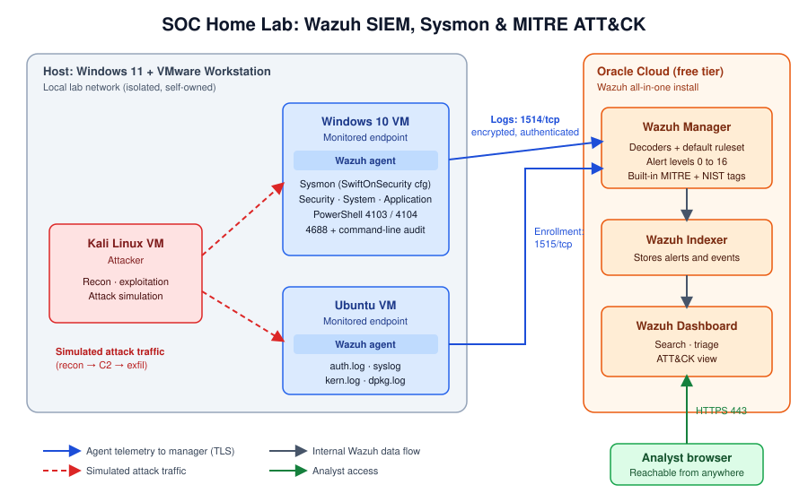

# SOC Home Lab: Wazuh SIEM, Sysmon & MITRE ATT&CK

A self-built Security Operations Center (SOC) home lab for practising the analyst side of
detection: deploying a SIEM, onboarding log sources over an encrypted pipeline, simulating
attacker behaviour, and triaging the alerts that Wazuh's built-in ruleset generates, mapped to
the MITRE ATT&CK framework.

> Dashboard screenshots are not yet included and will be added once the lab is redeployed on
> the architecture below.

## Objectives

- Stand up a working SIEM/XDR platform from scratch (Wazuh) rather than just reading about one.
- Onboard a realistic mix of Windows and Linux log sources over an encrypted transport.
- Understand how Wazuh's default ruleset classifies events, and read alerts by rule level,
  MITRE ATT&CK technique and compliance tags.
- Simulate attacker behaviour from a Kali VM and check what the lab does and does not see.
- Triage alerts: correlate related events, find the root cause, and separate real findings from noise.

## Architecture

The host machine runs Windows 11 with VMware, hosting three local VMs: **Windows 10** and
**Ubuntu** as the monitored endpoints, and **Kali Linux** as the attacker. The Wazuh manager,
indexer and dashboard run separately on a free-tier Oracle Cloud instance, which both local
endpoints register with as agents.

## Core Components

| Component | Role |
|---|---|
| Wazuh Manager, Indexer & Dashboard | All-in-one install on a free-tier Oracle Cloud instance; applies decoders and rules, stores alerts, and provides the search/triage UI |
| Wazuh Agent | Installed on the Windows 10 and Ubuntu VMs; collects logs and forwards them to the cloud manager |
| Sysmon | Installed on the Windows 10 VM for process, network and registry telemetry |
| Kali Linux | Local VM used to generate simulated attack traffic against the Windows 10 and Ubuntu VMs |

## Log Sources

| Endpoint | Log channels / files |
|---|---|
| Windows 10 | Security, System, Application, Sysmon (`Microsoft-Windows-Sysmon/Operational`), PowerShell (`Windows PowerShell` / `PowerShell-Operational`) |
| Ubuntu | `/var/log/auth.log`, `/var/log/syslog`, `/var/log/kern.log`, `/var/log/dpkg.log` |

Both endpoints forward these logs to the Wazuh manager over the TLS-encrypted Wazuh agent
connection.

## Implementation Steps

1. **Set up the local lab on VMware** on a Windows 11 host, with three VMs: Windows 10 and
   Ubuntu as monitored endpoints, and Kali Linux as the attacker.
2. **Deployed the Wazuh server** (manager, indexer and dashboard, all-in-one install) on a
   free-tier Oracle Cloud instance, kept separate from the local VMs so the dashboard and alert
   history are reachable from anywhere, not just the lab network.
3. **Installed Wazuh agents** on the Windows 10 and Ubuntu VMs, registering each against the
   cloud manager's public IP.
4. **Installed and configured Sysmon** on the Windows 10 endpoint using the SwiftOnSecurity
   config as a baseline, to capture process creation, network connections and registry
   activity that native Windows logging misses by default.
5. **Enabled the Windows audit policies** needed for Event ID 4688 (process creation) with
   command-line auditing, plus PowerShell Module and Script Block logging (Event IDs 4103/4104).
6. **Relied on the Wazuh agent's built-in encrypted channel** for log transport instead of
   plain syslog, since syslog over UDP is unencrypted and can be read, spoofed or dropped in
   transit. Agents enroll with the manager on port 1515 and ship logs over an authenticated,
   encrypted connection on port 1514.
7. **Used Wazuh's default ruleset** for detection. The built-in Windows and Linux rule files
   (see below) decode the incoming logs and raise alerts with a severity level, MITRE ATT&CK
   technique and compliance tags already attached.
8. **Simulated attacks from Kali** against both endpoints, following the stages of the
   Lockheed Martin Cyber Kill Chain (recon, delivery, exploitation, command and control,
   actions on objectives), to generate matching telemetry.
9. **Triaged the resulting alerts** in the dashboard: filtered by rule level and technique,
   correlated related log entries, investigated root cause, and separated true findings from noise.

## Detection Approach: Wazuh's Built-in Ruleset

This lab uses Wazuh's default rules rather than custom ones. The rule files relevant to the
monitored endpoints are:

| Endpoint | Rule files used |
|---|---|
| Windows 10 | `0575-win-base`, `0580-win-security`, `0585-win-application`, `0590-win-system`, `0595-win-sysmon`, `0600-win-wdefender` |
| Ubuntu | `0020-syslog`, `0085-pam`, `0095-sshd`, `0285-systemd` |

Every rule carries a severity level from 0 to 16, which drives how an alert is triaged:

| Level | Meaning | Triage action |
|---|---|---|
| 0 to 2 | Ignored, or low-relevance context | Not alerted by default (default alert threshold is level 3) |
| 3 | Successful or authorized events | Context only |
| 5 | User-generated error (e.g. a missed password) | Usually noise on its own |
| 8 | First-time-seen or security-relevant action | Review |
| 9 | Error from an invalid source, e.g. unknown user or root account | Review, especially if repeated |
| 10 | Multiple user-generated errors (e.g. repeated failed logins) | Investigate, may indicate an attack |
| 12 | High-importance event | Investigate |
| 14 and above | High-importance security event, usually via correlation | Immediate attention |

## MITRE ATT&CK Techniques Exercised

| Technique | Description | Telemetry the lab uses to see it |
|---|---|---|
| T1059: Command and Scripting Interpreter | Attacker runs commands via PowerShell, cmd or bash | Sysmon Event ID 1, Security Event ID 4688 with command lines, PowerShell Event ID 4104 |
| T1078: Valid Accounts | Attacker uses stolen or default credentials | Windows logon events (4624 / 4625) and Ubuntu `auth.log` entries |
| T1041: Exfiltration Over C2 Channel | Data sent out over the same channel used for command and control | Sysmon network connection events (Event ID 3); limited visibility, see Limitations |

## Results

- Built a working SIEM pipeline: two endpoints reporting to a cloud-hosted Wazuh manager over
  an encrypted channel, with Windows telemetry enriched by Sysmon and PowerShell logging.
- Alerts from both endpoints were searchable and filterable by rule level and MITRE technique
  in the Wazuh dashboard.
- Simulated attacks produced alerts that could be traced back to the originating log events
  and triaged by severity.
- Detection coverage was not benchmarked numerically. Alerts were reviewed qualitatively
  rather than scored.

## Limitations

- This is a home-lab environment, not a production SOC. Log volume and traffic are far
  smaller and less noisy than a real enterprise network.
- Detection relies on Wazuh's default ruleset. No custom rules have been written yet, so
  coverage is limited to what ships with Wazuh.
- Attack simulation was manual, not live adversary traffic, and covered a small set of
  techniques.
- Wazuh has no network flow visibility in this setup, so techniques such as exfiltration
  (T1041) are only partially observable through Sysmon network events.

## Future Improvements

- [ ] Write custom rules in `local_rules.xml` for specific behaviours (e.g. encoded PowerShell),
      tagged with MITRE ATT&CK and NIST SP 800-53.
- [ ] Tune noisy built-in rules using `frequency`, `timeframe` and exclusions, and measure
      the alert reduction.
- [ ] Automate the attack simulation with Atomic Red Team for repeatable testing, and record a
      detection rate per technique.
- [ ] Add Wazuh's vulnerability detection and Security Configuration Assessment (SCA) modules.
- [ ] Add network telemetry (Suricata or Zeek) to improve visibility of C2 and exfiltration.
- [ ] Forward alerts to a SOAR-style active response for automated containment.
- [ ] Expand log sources to cloud telemetry (e.g. AWS CloudTrail).

## Disclaimer

This lab was built entirely in an isolated, self-owned environment for learning purposes.
No real organizations' systems or data were involved.
